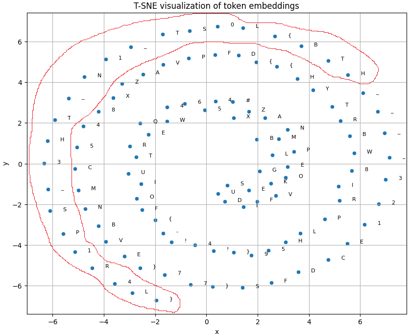

# Introduction

This is a medium-difficulty Hack The Box challenge in the `AI - ML` category.

# Challenge Description

A cube is the shadow of a tesseract cast onto three dimensions. I wonder what other secrets the shadows may hold.

# Solution

Install the required visualization and machine-learning libraries:

```python
%pip install seaborn scikit-learn
```

First, load the supplied `.npz` file and inspect its two arrays: `tokens` and `embeddings`.

```python
import numpy as np

data = np.load("token_embeddings.npz")
tokens, embeddings = data["tokens"], data["embeddings"]
print(tokens.shape)
print(embeddings.shape)
```

Result:

```text
(110,) <class 'numpy.ndarray'>
(110, 512)
```

A useful first step for high-dimensional embeddings is to reduce them to two dimensions and inspect the result with a scatter plot. Each token corresponds to one 512-dimensional embedding, so t-SNE can project those embeddings into a space that is easier to visualize.

```python
from sklearn.manifold import TSNE
import pandas as pd
import seaborn as sns
import matplotlib.pyplot as plt

reducer = TSNE(n_components=2, perplexity=30, learning_rate=5, random_state=40)
reduced = reducer.fit_transform(embeddings)
df = pd.DataFrame(reduced, columns=["x", "y"])
df["token"] = tokens

plt.figure(figsize=(10, 8))
sns.scatterplot(data=df, x="x", y="y")

for i in range(len(df)):
    plt.text(df.loc[i, "x"] + 0.5, df.loc[i, "y"], df.loc[i, "token"], fontsize=8)

plt.title("t-SNE visualization of token embeddings")
plt.grid(True)
plt.show()
```

The projected tokens reveal the `HTB{...}` flag in the region highlighted in red below.

{: width="972" height="589" }

_Result after running the visualization._
